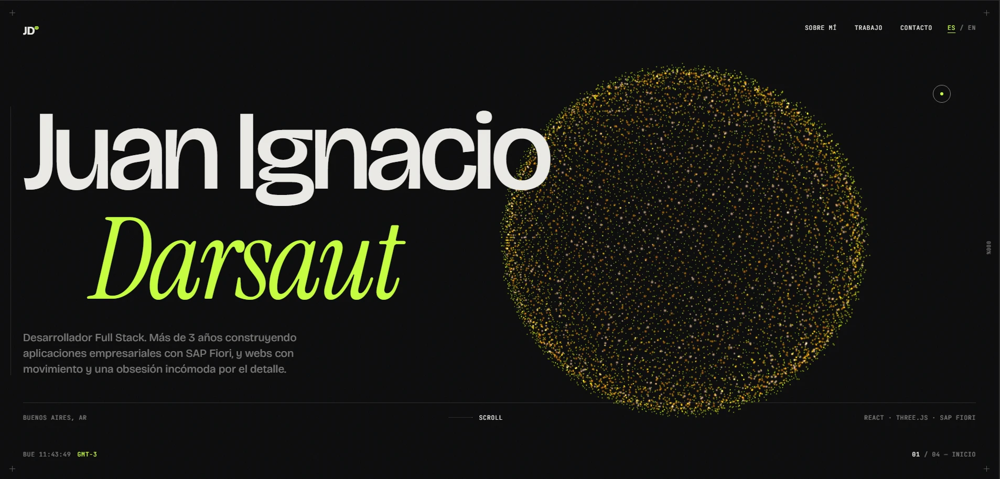

# Juan Ignacio Darsaut — Portfolio

Portfolio personal de desarrollador full stack: una sola página, bilingüe (español / inglés), con una escena 3D que cambia de forma a medida que se recorre el sitio.

**Ver en vivo → https://juandarsaut-portfolio.pages.dev**




## Qué tiene

- **Nube de 9.000 partículas** (5.000 en celular) que muta entre cuatro formas, una por sección: esfera, nudo, ondas y galaxia. Las partículas se apartan del cursor.
- **Título con tipografía variable:** las letras cercanas al mouse ganan peso sin que el renglón se mueva.
- **Manifiesto que se ilumina palabra por palabra** con el scroll.
- **Trayectoria** con una línea que se dibuja al avanzar.
- **Proyectos con vista previa que sigue al cursor** y un **caso de estudio** a pantalla completa por proyecto: rol, stack, detalles técnicos, link al sitio y al código.
- **Cursor propio** con etiquetas contextuales ("Ver caso", "Escribir", "Bajar"…).
- **HUD** con reloj de Buenos Aires, sección actual y progreso de lectura.
- **Español / inglés** sin recargar la página; el CV que se descarga cambia según el idioma.

## Decisiones técnicas

- **Las formas se interpolan en la GPU.** Las cuatro formas viajan como atributos del mismo `BufferGeometry` y el vertex shader mezcla entre ellas según el progreso del scroll. Cada partícula tiene un desfase propio, así la transición fluye en lugar de moverse en bloque.
- **La repulsión del cursor se calcula en espacio de pantalla**, de modo que el hueco queda justo bajo el puntero sin importar la profundidad de cada partícula.
- **Estado fuera de React.** Mouse, scroll y progreso viven en un objeto compartido (`src/state.js`) que se lee en cada frame: las animaciones no provocan re-renders.
- **Un solo reloj.** Lenis (scroll suave) y ScrollTrigger corren sobre el ticker de GSAP, así el scroll y las animaciones quedan sincronizados.
- **Reveals con IntersectionObserver** en vez de ScrollTrigger: más robustos cuando el alto de la página cambia (por ejemplo, al cambiar de idioma).
- **Caso de estudio accesible:** diálogo con `aria-modal`, foco al abrir y devuelto al cerrar, cierre con Esc y el resto de la página `inert` mientras está abierto.

## Accesibilidad y rendimiento

- Respeta `prefers-reduced-motion`: sin scroll suave, pantalla de carga casi instantánea, sin el efecto de tipografía del título y la trayectoria y los casos de estudio sin animación.
- En pantallas táctiles no hay cursor propio ni efectos que dependan del hover.
- Menos partículas en celular.
- Los assets del build llevan hash y se cachean un año (`public/_headers`).
- Metadatos Open Graph para que el link se vea bien en LinkedIn y WhatsApp.

## Stack

| Área | Herramientas |
| --- | --- |
| UI | React 18, Vite 7 |
| 3D | Three.js, React Three Fiber, GLSL |
| Animación | GSAP + ScrollTrigger, Lenis |
| Estilos | CSS puro con variables (sin framework) |
| Deploy | Cloudflare Pages |

## Correr el proyecto

Requiere Node 22 (ver `.node-version`).

```bash
npm install
npm run dev      # http://localhost:5173
npm run build    # build de producción en dist/
npm run preview  # sirve el build localmente
```

## Estructura

```
src/
  data.js         contenido fijo: contacto, proyectos, trayectoria, stack
  i18n.jsx        todos los textos en español e inglés
  state.js        estado compartido (mouse, scroll) y progreso por sección
  lib.js          helpers de animación (reveal, scramble)
  styles.css      estilos y variables de diseño
  components/
    Scene.jsx       nube de partículas y shaders
    Hero.jsx        título con tipografía variable
    About.jsx       sobre mí y trayectoria
    Work.jsx        proyectos y otros proyectos
    CaseStudy.jsx   panel de caso de estudio
    Contact.jsx     contacto y pie
    Hud.jsx         navegación, idioma, reloj y progreso
    Cursor.jsx      cursor propio
    Preloader.jsx   pantalla de carga
public/
  cv/             CV en PDF, uno por idioma
  _headers        cabeceras de caché para Cloudflare Pages
```

El contenido está separado del código: datos en `data.js` y textos en `i18n.jsx`.

## Deploy

Cloudflare Pages está conectado al repo: cada push a `main` publica una versión nueva (build `npm run build`, salida `dist`).

## Contacto

- Email: darsaut.juani@gmail.com
- LinkedIn: https://www.linkedin.com/in/juan-ignacio-darsaut-86ba88247
- GitHub: https://github.com/Juanii10
